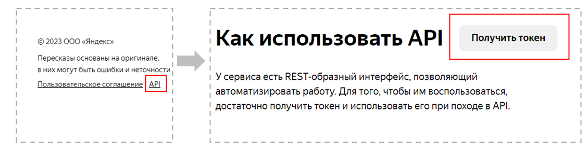

<!-- README.md is generated from README.Rmd. Please edit that file -->

# r300ya

**English** \|
[Русский](https://github.com/KobzevAY/r300ya/blob/master/README.ru.md)

<!-- badges: start -->

[](https://github.com/KobzevAY/r300ya/actions/workflows/R-CMD-check.yaml)
<!-- badges: end -->

**r300ya** is an R interface to the Yandex service <https://300.ya.ru>.
The service uses the YandexGPT neural network to retell a web page: it
returns the title and a list of the main theses.

## Installation

Install the development version from
[GitHub](https://github.com/KobzevAY/r300ya):

``` r
install.packages("remotes")
remotes::install_github("KobzevAY/r300ya")
```

## Getting a token

Any user signed in to Yandex can get a token on 300.ya.ru as shown
below:

<figure>

<figcaption aria-hidden="true">How to get a token on
300.ya.ru</figcaption>
</figure>

Rather than writing the token in your scripts, store it in your
`.Renviron` file (open it with `usethis::edit_r_environ()`):

    YA300_TOKEN=your_token

After restarting R the package picks the token up automatically.

## Example

The main function, `retell_text()`, takes two arguments:

- `url`: the link to the original page;
- `token`: your token (by default taken from the `YA300_TOKEN`
  environment variable).

``` r
library(r300ya)

res <- retell_text("https://habr.com/ru/news/729422/")
res
#> «Яндекс Браузер» научили переводить с китайского языка и автоматически накладывать русскую озвучку
#> * Яндекс Браузер научился переводить видео с китайского языка
#> * Технология работает на YouTube и будет добавлена на Bilibili
#> * Разработчики создали датасет из 1,5 млн видео с субтитрами на севернокитайском языке
#> * ...
#>
#> Retelling: https://300.ya.ru/3fOcYRBL
#> Original:  https://habr.com/ru/news/729422/
```

The result is a list with elements:

- `title`: the article title;
- `short_text`: the theses of the short retelling (a character vector);
- `theses`: the detailed retelling, a data frame with columns `chapter`
  and `thesis`;
- `short_url`: the link to the retelling on 300.ya.ru;
- `original_url`: the original link.

The original page can be in any language; YandexGPT will try to retell
it. Retellings are produced in Russian.

See `vignette("r300ya")` or the [Get
started](https://kobzevay.github.io/r300ya/articles/r300ya.html) page on
the website for a longer walkthrough.

## Limitations and errors

The service cannot retell a page if:

- the page is too long;
- the link points to a file (e.g. `*.pdf`) rather than an article;
- the page has too little text.

In these cases, and when the token is wrong, `retell_text()` throws an
error. Each error has a class, so you can handle them:

- `r300ya_error_token`: the token is missing or rejected;
- `r300ya_error_api`: the service could not retell the page (the message
  includes the reason);
- `r300ya_error_parse`: the retelling page could not be parsed (most
  likely 300.ya.ru changed its layout; please report it in the
  [issues](https://github.com/KobzevAY/r300ya/issues));
- `r300ya_error_input`: `url` is invalid.

For example, to retell several pages and skip the ones that fail:

``` r
urls <- c("https://habr.com/ru/news/729422/", "https://example.com/file.pdf")

results <- lapply(urls, function(u) {
  tryCatch(retell_text(u), r300ya_error_api = function(e) NULL)
})
```

## Terms of use

r300ya is an unofficial package, not affiliated with Yandex. It only
automates requests you could make yourself on <https://300.ya.ru> with
your own token, and by using it you accept the [300.ya.ru terms of
use](https://yandex.ru/legal/300ya_termsofuse/) and the [Yandex user
agreement](https://yandex.ru/legal/rules/). In particular (as of the
version of 8 February 2024):

- the service and the retellings may be used **for personal,
  non-commercial purposes only** (clauses 2.4, 3.2);
- retellings **must not be used to train or test AI models** (clause
  3.6);
- you must not retell or share pages with illegal, offensive or
  copyright-infringing content (clause 2.5), and you are responsible for
  checking the retellings;
- retellings of web pages are published on 300.ya.ru and are available
  to anyone with the link (clause 2.1.1);
- Yandex may restrict automated access to its services (user agreement),
  so do not send large numbers of requests.
