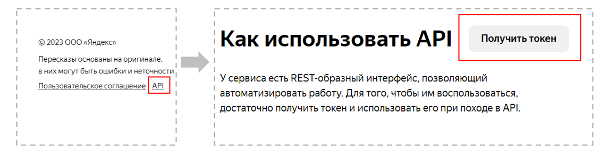

# r300ya

[English](README.md) | **Русский**

<!-- badges: start -->

[](https://github.com/KobzevAY/r300ya/actions/workflows/R-CMD-check.yaml)
<!-- badges: end -->

Пакет **r300ya** даёт доступ из R к сервису Яндекса <https://300.ya.ru>
через API. Сервис с помощью YandexGPT автоматически делает краткий
пересказ интернет-страницы: заголовок и список главных тезисов.

## Установка

Установить **r300ya** можно с
[GitHub](https://github.com/KobzevAY/r300ya):

``` r
# install.packages("pak")
pak::pak("KobzevAY/r300ya")
```

## Получение токена

Токен может получить авторизованный пользователь сервисов Яндекса по
следующей схеме:

<figure>

<figcaption aria-hidden="true">Схема получения значения токена на
сервисе 300.ya.ru</figcaption>
</figure>

Токен лучше не писать в скриптах, а сохранить в файле `.Renviron`
(открыть его можно командой `usethis::edit_r_environ()`):

    YA300_TOKEN=ваш_токен

После перезапуска R пакет подхватит токен автоматически.

## Пример

Основная функция `retell_text()` принимает на вход 2 параметра:

- `url`: ссылка на оригинальную страницу;
- `token`: токен (по умолчанию берётся из переменной окружения
  `YA300_TOKEN`).

``` r
library(r300ya)

res <- retell_text("https://habr.com/ru/news/729422/")
res
#> «Яндекс Браузер» научили переводить с китайского языка и автоматически накладывать русскую озвучку
#> * Яндекс Браузер научился переводить видео с китайского языка
#> * Технология работает на YouTube и будет добавлена на Bilibili
#> * Разработчики создали датасет из 1,5 млн видео с субтитрами на севернокитайском языке
#> * ...
#>
#> Retelling: https://300.ya.ru/3fOcYRBL
#> Original:  https://habr.com/ru/news/729422/
```

Результат — список с элементами:

- `title`: заголовок статьи;
- `short_text`: тезисы краткого пересказа (вектор строк);
- `theses`: подробный пересказ, таблица с колонками `chapter` (раздел) и
  `thesis` (тезис);
- `short_url`: ссылка на пересказ на 300.ya.ru;
- `original_url`: исходная ссылка.

Оригинальная страница может быть на любом языке, YandexGPT попробует её
пересказать.

## Ограничения и ошибки

Сервис не может пересказать страницу, если:

- страница слишком длинная;
- ссылка ведёт не на статью, а на файл, например `*.pdf`;
- на странице слишком мало текста.

В этих случаях, а также при неверном токене `retell_text()` выдаёт
ошибку. У каждой ошибки есть класс, поэтому их можно обрабатывать:

- `r300ya_error_token`: токен не указан или не подходит;
- `r300ya_error_api`: сервис не смог пересказать страницу (в сообщении
  указана причина);
- `r300ya_error_parse`: не удалось разобрать страницу с пересказом
  (скорее всего, 300.ya.ru изменил вёрстку — сообщите, пожалуйста, в
  [issues](https://github.com/KobzevAY/r300ya/issues));
- `r300ya_error_input`: неверно указан `url`.

Например, так можно пересказать несколько страниц и пропустить те, что
не получились:

``` r
urls <- c("https://habr.com/ru/news/729422/", "https://example.com/file.pdf")

results <- lapply(urls, function(u) {
  tryCatch(retell_text(u), r300ya_error_api = function(e) NULL)
})
```

Подробнее — в виньетке `vignette("r300ya")` (на английском).

## Условия использования

Пакет лишь автоматизирует запросы, которые вы могли бы сделать сами на <https://300.ya.ru>. Используя его, вы соглашаетесь с [условиями использования 300.ya.ru](https://yandex.ru/legal/300ya_termsofuse/).
