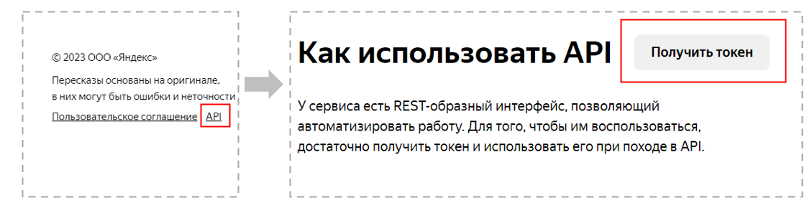

```{r, include = FALSE}
knitr::opts_chunk$set(
  collapse = TRUE,
  comment = "#>",
  # The code needs a personal token and internet access,
  # so it is not run when the vignette is built.
  eval = FALSE
)
```

[300.ya.ru](https://300.ya.ru) is a Yandex service that uses the YandexGPT
neural network to retell web pages: given a link, it returns the title of the
article and a list of its main theses. **r300ya** lets you do the same from R,
which is handy when you need to summarise many pages, e.g. for a news digest
or a literature review.

This vignette shows how to set up a token, retell a page, work with the result
and handle errors. The code below is not run when the vignette is built,
because it needs your personal token; the output shown is from a real session.

```{r setup}
library(r300ya)
```

## Setting up a token

The service requires an OAuth token. Any user signed in to Yandex can get one
on 300.ya.ru:

```{r token-image, echo = FALSE, eval = TRUE, out.width = "100%", fig.alt = "How to get a token on 300.ya.ru"}

```

`retell_text()` reads the token from the `YA300_TOKEN` environment variable,
so you do not need to put it in your code. The most convenient place for it is
your user-level `.Renviron` file:

```{r}
file.edit("~/.Renviron") # or usethis::edit_r_environ()
# add the line
# YA300_TOKEN=your_token
# save the file and restart R
```

For a one-off session you can also set it directly:

```{r}
Sys.setenv(YA300_TOKEN = "your_token")
```

or pass it explicitly with `retell_text(url, token = "your_token")`.

## Retelling a page

Pass the URL of the page to `retell_text()`:

```{r}
res <- retell_text("https://habr.com/ru/news/729422/")
res
#> «Яндекс Браузер» научили переводить с китайского языка и автоматически накладывать русскую озвучку
#> * Яндекс Браузер научился переводить видео с китайского языка
#> * Технология работает на YouTube и будет добавлена на Bilibili
#> * Разработчики создали датасет из 1,5 млн видео с субтитрами на севернокитайском языке
#> * Нейросеть научилась понимать иероглифы и использовать словарь из 10 тысяч токенов
#> * Нейросеть также научилась делить поток иероглифов на смысловые отрезки для синхронизации перевода
#> * Китайский язык имеет четыре тона, определяющие смысл сказанного
#> * Нейросеть справилась с изучением тонов за месяц
#> * В китайском много омофонов, которые нейросеть различает с учетом контекста
#>
#> Retelling: https://300.ya.ru/3fOcYRBL
#> Original:  https://habr.com/ru/news/729422/
```

The page can be in any language; the retelling is produced in Russian.

## Working with the result

The result is a list of class `r300ya_retelling`:

```{r}
str(res, max.level = 1)
#> List of 5
#>  $ title       : chr "«Яндекс Браузер» научили переводить с китайского языка и автоматически накладывать русскую озвучку"
#>  $ short_text  : chr [1:8] "Яндекс Браузер научился переводить видео с китайского языка" ...
#>  $ theses      :'data.frame':	15 obs. of  2 variables:
#>  $ short_url   : chr "https://300.ya.ru/3fOcYRBL"
#>  $ original_url: chr "https://habr.com/ru/news/729422/"
#>  - attr(*, "class")= chr [1:2] "r300ya_retelling" "list"
```

* `short_text` is the short retelling, one thesis per element.
* `theses` is the detailed retelling, grouped by the chapters the service
  identified in the article:

```{r}
head(res$theses, 4)
#>                            chapter                                                             thesis
#> 1 Перевод видео с китайского языка «Яндекс Браузер» научился переводить видео с китайского на русский.
#> 2 Перевод видео с китайского языка              Технология автоматически накладывает русскую озвучку.
#> 3               Поддержка платформ                                  Технология работает на YouTube.
#> 4               Поддержка платформ          Планируется поддержка китайской видеоплатформы Bilibili.
```

* `short_url` is a link to the retelling on 300.ya.ru that you can share.

## Retelling several pages

`retell_text()` works with one URL at a time. To process many pages, loop
over them and turn the results into a single data frame:

```{r}
urls <- c(
  "https://habr.com/ru/news/729422/",
  "https://example.com/report.pdf"
)

results <- lapply(urls, function(u) {
  tryCatch(retell_text(u), r300ya_error = function(e) {
    message("Skipped ", u, ": ", conditionMessage(e))
    NULL
  })
})
#> Skipped https://example.com/report.pdf: 300.ya.ru could not retell https://example.com/report.pdf (...)

results <- Filter(Negate(is.null), results)

digest <- do.call(rbind, lapply(results, function(r) {
  data.frame(url = r$original_url, title = r$title, thesis = r$short_text)
}))
```

Please be considerate and do not send hundreds of requests in a row: add a
pause with `Sys.sleep()` between calls if you process many pages.

## Handling errors

`retell_text()` signals errors with `stop()`. Every error has class
`r300ya_error` and one more specific class, so you can react to each case
separately with `tryCatch()`:

| Class                | Meaning                                                                 |
|----------------------|-------------------------------------------------------------------------|
| `r300ya_error_input` | `url` is not a single `http(s)://` string                               |
| `r300ya_error_token` | the token is missing or was rejected by the service                     |
| `r300ya_error_api`   | the service could not retell the page (too long, too short, not HTML…) |
| `r300ya_error_parse` | the retelling page has an unexpected structure                          |

```{r}
tryCatch(
  retell_text("https://habr.com/ru/news/729422/", token = "wrong"),
  r300ya_error_token = function(e) message("Please check your token")
)
#> Please check your token
```

A `r300ya_error_parse` error most likely means that 300.ya.ru changed the
layout of its pages. Please report it at
<https://github.com/KobzevAY/r300ya/issues>.

## Terms of use

The package only automates requests you could make yourself on
<https://300.ya.ru>. By using it you agree to the
[300.ya.ru terms of use](https://yandex.ru/legal/300ya_termsofuse/).
